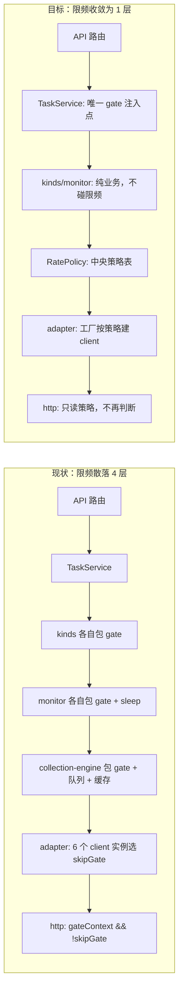

# 闸门 / 接口 / 架构评审与重构方案（v1 · 已实施）

> 评审范围：闸门（`request-gate` / `http`）、平台适配层（`adapters/*`）、任务引擎（`engine/*`）、
> 收藏夹共享引擎（`collection-engine-service` / `collection-index`）、各监控循环（`src/*-monitor.ts`）。

---

## ✅ 实施结论（2026-11-20）

P0 + P1 已全部落地，并按用户拍板采用了**比原提案更彻底**的定义：

> **闸门是 HTTP 出口的默认属性，不是调用方申请的许可。** 所有一手请求默认按
> 「出口 IP + 账号 UID」两级令牌排队；唯一豁免是下单（`order.checkout`）与登录
> （`auth.login`）。请求身份由请求自身凭证决定，不注入隐式上下文。

关键结果：
- **删除了整套隐式上下文**：`GateContext` / `GateTaskKind` / `runWithGateContext` /
  `getGateContext` 全部移除，gate 上下文注入点 **7 处 → 0 处**；监控循环、收藏引擎、
  订单续期不再包 gate 上下文。ASCII 全局搜索这些符号已零残留。
- **显式身份 `GateIdentity { flow, queueKey?, accountKey?, localAddress? }`**：由一手 client
  从账号快照组装，随请求带到 HTTP 出口；`flow` 用点分命名
  （`monitor.stock` / `collection.write` / `order.renew` / `order.checkout` …）。
- **中央策略表 `RATE_POLICIES`**（`src/utils/rate-policy.ts`）：闸门策略、额外节流
  （收藏写 300ms、续期读 300ms/写 5s）、缓存 TTL（索引 10s）全部集中一处，业务代码的
  硬编码常量改为从此派生。**行为数值一律沿用重构前值，本次不改线上节奏。**
- **适配层收敛**：`writeClient`（与 `directClient` 重复）删除，client 实例 6 → 5；
  `getProductSkus(id, skipGate?)` 的限流参数从领域接口移除，下单预检改用独立方法
  `getOrderProductSkus(id)`（bypass 通道）；`getRenewAdapter` 用显式 `asRenewAdapter()` 视图 +
  集中能力键检测，去掉散落的 `as unknown as` duck typing。
- **验证**：TypeScript 编译通过；测试 **501 → 506 全绿**（新增 rate-policy 4 项 + client 1 项，
  重写 request-gate 测试为显式身份模型）。

> 原提案下文的"待拍板"部分已按用户选择落实：力度=P0+P1 一起；flow 命名=点分；
> 豁免=仅下单 + 登录（不考虑历史包袱的最合理定义）。下文正文保留作为设计依据与背景。

---

## 一、一句话结论

**引擎层已经很干净，复杂度几乎全部堆在"限频"这一个横切关注点上。**

任务引擎（`TaskKindDefinition` / `TaskService` / `TaskRegistry` / 通用 handlers）、统一循环骨架
（`runMonitorLoop`）、全量索引（`createCollectionIndex` 的 singleflight + TTL + 增量维护）这三块，
分层和职责都清晰，是项目里应该保留的范本。

真正的问题是：**"要不要限流、按什么限、额外延迟多久"这件事，被实现成了散落在 8+ 处的隐式约定**——
gate 上下文注入、`skipGate` 布尔、`300ms/5s` 的硬编码 sleep、per-货号队列、全局加收藏队列、TTL 缓存。
它们口径不统一、命名名不副实、职责跨界，这正是最近一连串线上问题（脏 `collectId`、`checkCount=0`、
任务空转）的共同土壤。

建议：**不动引擎层，把限频收敛成一个显式的中央策略层**，其余保持现状。

---

## 二、现状分层 vs 目标分层



职责应改成：

| 层 | 现在实际在做 | 应该只做 |
|---|---|---|
| 编排层（TaskService / definition） | 生命周期 + 部分 gate 注入 | 生命周期 + **唯一的 gate 注入** |
| 监控循环（monitor） | 业务 + gate 注入 + 额外 sleep | 纯业务节奏（周期、冷却） |
| 限频策略层（**缺失，需新建**） | 散在各处 | gate / 间隔 / 串行 / 缓存的统一声明 |
| 协议适配层（adapter / client） | 协议 + 用哪个 client 表达限频 | 纯协议：发什么、怎么映射 |

---

## 三、问题清单（按严重度，附代码证据）

### P1 · gate 上下文注入分散，且 `GateTaskKind` 名不副实

- `runWithGateContext` 在 **7 处** 被手工调用，每处都要手填 `{taskId, kind, accountKey, localAddress}`：
  `stock-monitor.ts:238`、`price-monitor.ts:449`、`tab-list-monitor.ts:414`、`order-renew-monitor.ts:385`、
  `collection-monitor.ts:161`、`collection-engine-service.ts:103`、`collection-engine-service.ts:148`。
- `GateTaskKind = 'stock' | 'price' | 'tab'`（`request-gate.ts:24`），但续期、收藏读写、索引加载
  **全部硬编码 `kind: 'stock'`**（`order-renew-monitor.ts:388`、`collection-engine-service.ts:106/151`、
  `collection-monitor.ts:164`）。注释说 kind "仅用于统计展示"，于是 `/api/gate/stats` 把这些流量
  全算成 stock，排障时看不到收藏/续期的真实排队情况。
- `taskId` 被塞进伪值：`'collection-add'`、`'collection-remove'`、`'collection-index'`、
  `'collection-engine'`、`'renew-<uid>'`、`'order-renew'`。它本意是"任务级公平调度的 key"
  （`request-gate.ts:31`），实际承担了"业务流标识"。语义混淆，但恰好让同类请求归入同一子队列——
  这个**意外效果应该被显式化**，而不是靠伪值碰运气。

### P2 · `skipGate` 用"实例化哪个 client"表达，adapter 维护 6 个实例

`YishouAdapter` 构造函数里建了 6 个 client（`index.ts:85-91`）：

| 实例 | 代理 | 闸门 | 超时 | 用途 |
|---|---|---|---|---|
| `client` | 是 | 走 | 10s | 常规查询 |
| `directClient` | 否 | 走 | 10s | 收藏夹列表读 |
| `writeClient` | 否 | 走 | 10s | 收藏夹写——**配置与 directClient 完全相同** |
| `orderSkuClient` | 是 | **skip** | 10s | 下单预检 SKU |
| `order` | 是 | **skip** | 20s | 下单链路 |
| `renewOrder` | 是 | 走 | 20s | 续期链路 |

问题：`skipGate` 是"请求意图"，却被编码进"持有哪个实例"。同一能力（查商品详情）出现两个入口
（`fetchGoods(productId, skipGate)`），新增一种限频组合就得再造一个 client；
`writeClient` 与 `directClient` 是纯重复实例。

### P3 · 能力检测靠 duck typing + 视图 workaround

- `getOrderAdapter` 检测 5 个方法、`getRenewAdapter` 检测 3 个方法，均用 `as unknown as` 强转
  （`adapters/index.ts:34/56`）。
- 续期为了和下单一套 5 方法 mock 测试隔离，造了 `asRenewAdapter()` 手工视图（`yishou/index.ts:338`），
  再由 `getRenewAdapter` 做 duck typing 识别。能跑，但这是绕过类型系统的 workaround，
  "续期用哪个 client"的秘密藏在了视图工厂里。

### P4 · 限频三层口径分散，没有统一策略表

| 机制 | 参数 | 位置 |
|---|---|---|
| 闸门 | IP/UID 各 1s、maxWait 10min | `request-gate.ts:84-88` |
| 额外 sleep | 加收藏 300ms | `collection-engine-service.ts:80` |
| 额外 sleep | 续期读 300ms / 写 5s | `order-renew-monitor.ts:42/49` |
| 串行队列 | per-货号 + 全局加收藏 300ms | `collection-engine-service.ts:55/79` |
| 缓存 | 全量索引 TTL 10s + singleflight | `collection-index.ts` / `collection-engine-service.ts:31` |

用户能明确回答"哪些请求过闸门"已经很费劲（要翻 5 个文件）。改一个节奏值容易漏改另一处。

### P5 · 领域接口签名泄漏限流策略

`PlatformAdapter.getProductSkus(productId, skipGate?)`、`BaseAdapter` 同签名、
`AutoOrderAdapter` 同签名（`adapters/types.ts:48`、`auto-order.ts:58`）。
"走不走闸门"是调用场景的属性，不该出现在"取 SKU"的领域方法参数里。

### P6 · 手动 API 与后台任务共用门面，靠"有没有上下文"隐式区分

`addProductToCollection` 等门面函数被手动 API（`api/collection/add.post.ts`）和后台任务
（`collection-engine-service.ts`）共用，是否限流全靠"当前有没有 gate 上下文"这个隐式开关
（`http.ts:119-120`）。这个约定很强但很隐蔽，代码里已需大段注释解释。

> 保留项：`TaskService.restart/stop/extend` 对 controller 的处理、`registry.removed` 防回写、
> `collection-index` 的 singleflight + 增量维护、凭证不落盘按 ID 现取——这些都设计正确，不要动。

---

## 四、重构方案（5 个模块）

### 模块 A · 统一 GateContext 语义 + 收敛注入点

**目标**：gate 上下文只在一处构造，kind/taskId 语义真实。

1. `GateTaskKind` 扩为覆盖全部流量，并改名为更贴切的 `GateFlow`：
   `monitor.stock | monitor.price | monitor.tab | collection.sync | collection.write | order.renew`。
   保留 `GateTaskKind` 别名兼容旧 import。
2. `GateContext` 拆分字段语义：`flow: GateFlow`（原 kind）、`taskId?: string`（真实任务 id，
   可空）、`queueKey: string`（公平调度 key，替代被滥用的伪 taskId）。
3. 提供唯一构造器 `makeGateContext(flow, {accountKey, localAddress, taskId?, queueKey?})`，
   7 处手工拼对象全部改调它。
4. **注入点收敛**：`TaskService.start()` 统一包一层 gate（kind 从 definition 拿）；
   monitor 与 kinds 删掉各自的 `runWithGateContext`。
   独立循环（collection-engine / renew）保留各自注入，但统一走 `makeGateContext`。

**收益**：注入点 7 → 2；`/api/gate/stats` 能按真实业务流看排队；伪 taskId 消失。

### 模块 B · adapter 工厂化，干掉 skipGate 实例选择

**目标**：限频策略不再以"持有哪个实例"表达。

1. 定义 `ClientPolicy = { useProxy: boolean; gate: 'normal' | 'bypass'; timeoutMs: number }`，
   `YishouClient` 构造改为吃一个 policy 对象（`skipGate` 由 `gate: 'bypass'` 派生，保留兼容读取）。
2. `YishouAdapter` 用 `clientFor(policy)` 工厂按策略取/建实例，删掉 `writeClient`（与
   `directClient` 重复），`client / directClient / orderSkuClient / order / renewOrder` 变成
   5 个显式 policy 常量。
3. `getProductSkus(id, skipGate?)` 的公开签名去掉第二参数；下单预检改用独立方法
   `getOrderProductSkus(id)`（内部走 bypass policy），领域接口只留 `getProductSkus(id)`。

**收益**：实例数 6→5 且各有明确 policy；领域签名不再泄漏限流；新增限频组合=加一个 policy 常量。

### 模块 C · 中央限频策略表（核心改动）

**目标**：所有"节奏"在一张表里，看一处就知道谁过闸门、谁额外延迟。

新建 `src/utils/rate-policy.ts`（或 `web/server/tasks/rate-policies.ts`）：

```ts
export const RATE_POLICIES = {
  monitorScan:        { gate: 'normal', gapMs: 0 },
  collectionScan:     { gate: 'normal', gapMs: 0, queue: 'engine' },
  collectionIndex:    { gate: 'normal', gapMs: 0, singleflight: true, ttlMs: 10_000 },
  collectionWrite:    { gate: 'normal', gapMs: 300, queue: 'per-product+global' },
  orderRenew:         { gate: 'normal', gapMs: 300, writeGapMs: 5_000 },
  checkout:           { gate: 'bypass' }, // 唯一豁免：抢库存
  manualApi:          { gate: 'none' },   // 无上下文，直接放行
} as const;
```

- `collection-engine-service.ts`、`order-renew-monitor.ts` 里的硬编码 sleep / 队列常量改从
  `RATE_POLICIES` 读（数值保持现状，先不改行为）。
- `http.ts` 不再自己判断 `skipGate`，改为从策略派生：`gate === 'normal' && gateContext` 才排队。

**收益**：回答"哪些过闸门、哪里绕过、哪里额外延迟"只需看一张表；改一个值一处生效。

### 模块 D · 能力矩阵显式化（可选，低优先）

用 `PlatformCapabilities` 结构声明每个平台支持的能力（collection/order/renew/search），
替换 `getOrderAdapter` / `getRenewAdapter` 的 duck typing 与 `as unknown as`。
`asRenewAdapter()` 视图随模块 B 完成后自然失去存在必要，可一并删除。

### 模块 E · 分层契约文档 + 命名对齐

在 `docs/ARCHITECTURE.md` 增补一节"限频与闸门"，写明三条铁律：
1. 只有编排层和独立循环能注入 gate 上下文；
2. 只有下单链路（`checkout`）可绕过闸门；
3. 任何额外延迟必须在 `RATE_POLICIES` 声明，不得写在业务代码里。

---

## 五、分期计划与优先级

| 期 | 模块 | 内容 | 风险 | 收益 |
|---|---|---|---|---|
| **P0** | A1-A3 + C | 扩 flow 类型、统一构造器、建策略表、散落常量改为读表（**行为不变**） | 低 | 定义清晰、可视、可讨论 |
| **P1** | A4 + B | 注入点收敛到 TaskService、adapter 工厂化、去掉 skipGate 参数 | 中 | 架构真正变干净 |
| **P2** | D + E | 能力矩阵、删视图 workaround、文档铁律 | 低 | 长期可维护 |

- P0 是纯整理，不改任何线上行为，可独立上线；P1 触及所有监控链接入，需完整回归。
- 当前闸门是"观察一手风控阈值的实验分支"，**重构期间不要同时调整 1s 阈值**，避免两个变量叠加。

---

## 六、风险与验收

- **测试**：现有 501 个用例需保持全绿。重点回归 `client.test` / `sku-detail.test` /
  `collection-add.test` / `collection-remove.test` / `renew.test` / `order.test` 中对 `skipGate` 的断言，
  以及 `request-gate.test`。
- **部署**：沿用 `deploy.sh` 的 pm2 + rsync 原子部署（`.output.next → .output`，保留
  `.output.prev`，不碰 `data`）。
- **验收口径**：
  1. `runWithGateContext` 调用点 ≤ 2（编排层 + 独立循环 helper）；
  2. 源码中 `skipGate` 仅出现在 `ClientPolicy` 派生处与 http 策略判断处；
  3. `/api/gate/stats` 能看到 collection / renew 的真实排队；
  4. 改一个节奏值只需改 `RATE_POLICIES` 一处；
  5. 回归 501 测试全绿，线上 restart 恢复后收藏夹通道任务 `checkCount` 正常增长。

---

## 七、需要你拍板的三个点

1. **改造力度**：先做 P0（纯整理、行为不变），还是 P0+P1 一起上？
2. **flow 命名**：用 `monitor.stock / collection.write / order.renew` 这种点分命名，
   还是保留 `'stock' | 'price' | 'tab' | 'collection' | 'renew'` 简单枚举？
3. **下单豁免**：是否维持现状（仅 checkout 绕过闸门，手动 API 无上下文放行）？
   若要"所有请求都过闸门"，需重新评估抢库存时效。
